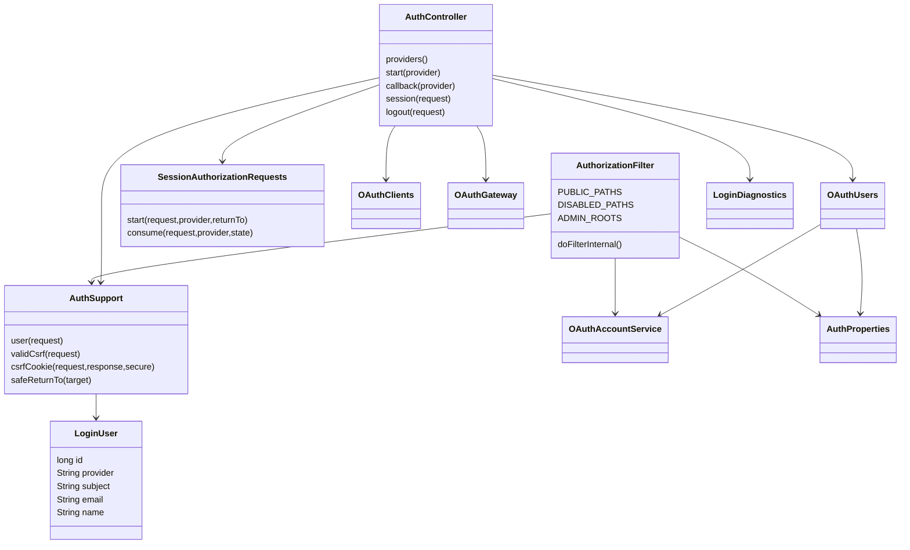
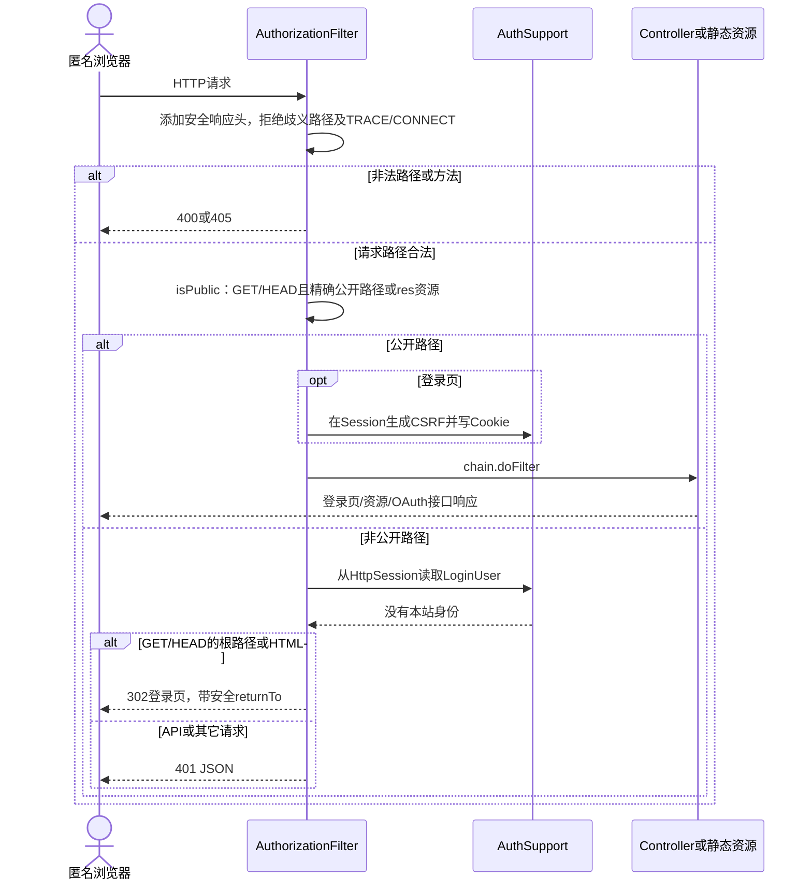
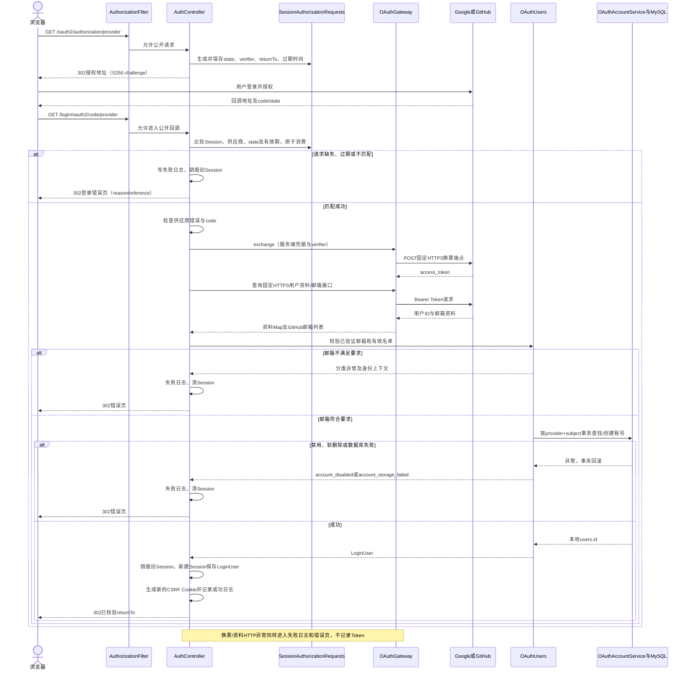
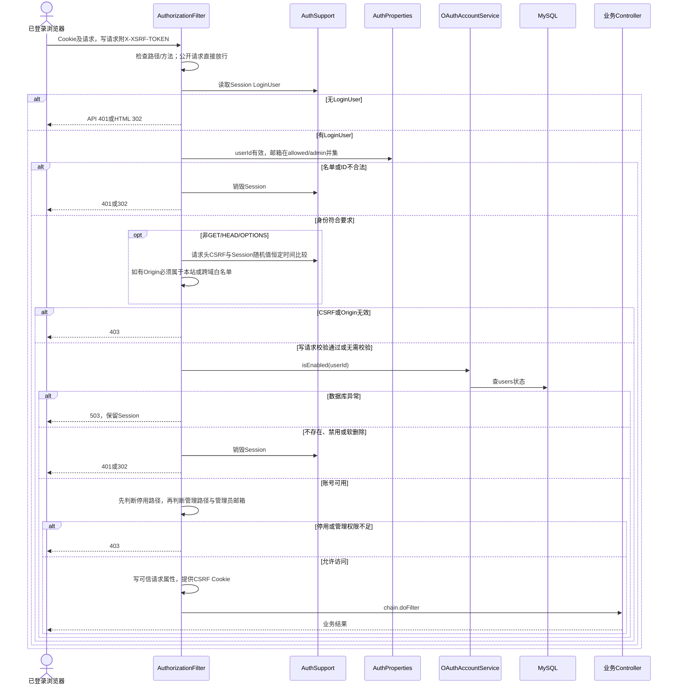
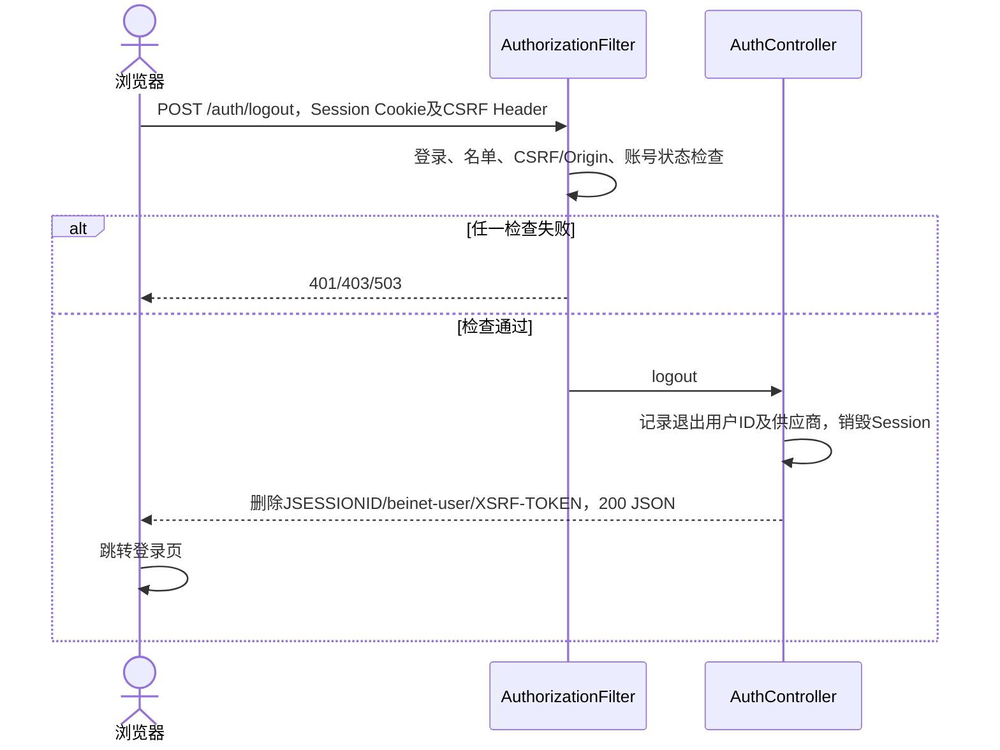
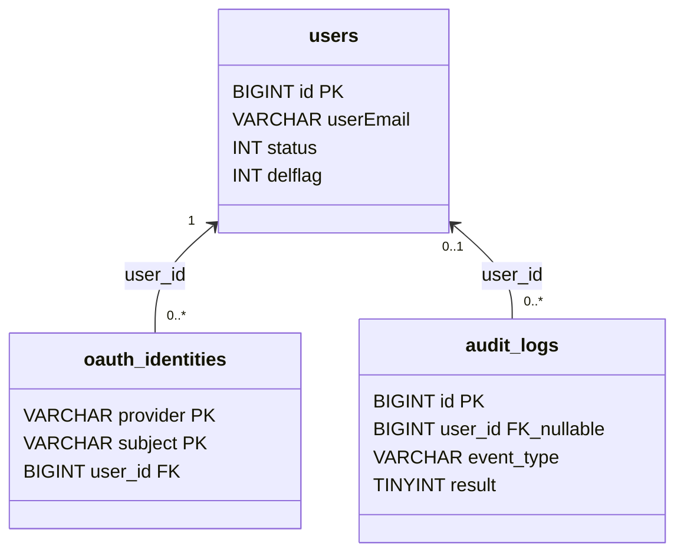
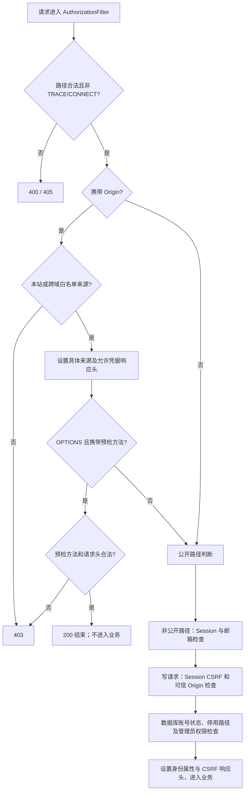

# 技术文档：普通 Controller + Session + AuthorizationFilter

对应 [REQ-AUTH-001](REQUIREMENTS.md)，更新日期：2026-10-21。

## 1. 最终结构与职责

已删除 SecurityConfiguration，移除 spring-boot-starter-oauth2-client、spring-security-test 及生产/测试代码中的 org.springframework.security 引用。不再使用 SecurityFilterChain、SecurityContextHolder、框架角色或 Spring OAuth 回调。

认证和权限由普通 Java 代码完成，前端继续使用 dp-admin 中的 Vue 2 页面，URL、auth 配置、数据库结构和邮箱准入规则保持兼容。旧 Spring Session 中的认证对象不再识别，部署后需要重新登录。

| 类 | 作用 |
| --- | --- |
| autoConfig.AuthorizationFilter | 普通 Servlet 过滤器，按 if/return 顺序检查路径、Session、邮箱、CSRF、账号状态及管理员权限 |
| auth.AuthController | 普通 MVC 接口，处理供应商列表、授权发起、回调、会话和退出 |
| auth.OAuthClients | 校验 base-url 和供应商成对凭据，提供固定授权、换票、用户资料端点 |
| auth.SessionAuthorizationRequests | 在 Session 保存待完成授权；state、供应商、五分钟有效期及原子消费 |
| auth.OAuthGateway | 使用 Spring Web RestClient 调用供应商 HTTPS 接口，服务端提交 code/verifier/凭据 |
| auth.OAuthUsers | 验证供应商邮箱、准入名单，调用本地账号持久化 |
| auth.LoginUser | Session 中的本站身份：id/provider/subject/email/name，不保存 Token |
| auth.AuthSupport | 会话读取/清理、CSRF、随机值、回跳校验及统一响应 |
| auth.LoginFailure / LoginDiagnostics | 受控错误分类、服务端身份上下文和异常链日志 |
| beinet-login/.../OAuthAccountService | 用户与第三方身份的事务持久化及账号状态校验 |

AuthorizationFilter 用 Component 和 Order 注册为普通 Servlet Filter，仅注册一次。继承 OncePerRequestFilter，默认不重复过滤内部 ERROR/ASYNC 派发；首次普通请求 /error 仍需登录。项目部署在根路径，不支持子路径部署。

## 2. 组件 UML



## 3. 匿名访问校验 UML



公开 GET/HEAD：/login.html、/auth/providers、/favicon.ico、/res/**、/oauth2/authorization/google、/oauth2/authorization/github、/login/oauth2/code/google、/login/oauth2/code/github。公开回调仍需 Controller 验证 state，不会直接建立身份。

过滤器拒绝路径中的百分号编码、分号、反斜杠、重复斜杠、点段和控制字符，避免容器解释与权限匹配不一致。此规则针对 URL 路径，不限制下载/文件接口查询参数中的编码文件名；新增需要编码路径的接口时必须评估此限制，不能直接放宽。

## 4. 登录流程 UML



### 4.1 Google 的身份来源

Google 使用 OAuth2 授权码流程，scope 为 userinfo.email/userinfo.profile 的完整 Google scope URL。后端用本站客户端凭据、回调地址、code 和 PKCE verifier 在固定 token 端点兑换 access_token，再调用 `https://www.googleapis.com/oauth2/v2/userinfo`。使用其 `id`、`email`、`verified_email`、`name`。

本版本不使用 OIDC ID Token，不接收浏览器提交的 JWT，不自行解析未验签 Token，也不再声称有 Spring 的 ID Token 签名/nonce 校验。身份信任来源是服务端自己兑换的 access_token 及 Google 固定 HTTPS 用户接口；邮箱必须 verified_email=true 且在名单中。原 Google sub 与此用户 ID 的既有账号对应关系须在目标账号联调中确认，不能按邮箱自动合并。

### 4.2 GitHub 与状态管理

GitHub scope 为 read:user/user:email，读取 /user 和 /user/emails?per_page=100。只选择 verified=true 且获准的邮箱，优先 primary=true；支持私有邮箱，当前最多取第一页100项。

state 和 verifier 均由 SecureRandom 生成32字节随机值，base64url无填充编码；授权时发送 SHA-256 的 code_challenge，换票时提交原始 verifier。每个 Session 只保留一笔请求，再次发起会替换旧请求，五分钟过期。consume 在会话锁内匹配并删除，防止并发重放；供应商错误也先校验 state。

所有外部请求使用固定 HTTPS URL，连接超时10秒、读取超时15秒，不跟随重定向。Token 只在回调方法内临时使用，不持久化、不发送给前端。会话中仅保存 LoginUser，登录成功销毁旧会话并重新生成，防止 Session 固定攻击。

## 5. 登录后校验 UML



停用路径：旧登录与回调示例、/demo及子路径、在线解密、RAR解压、目录提级。管理员也不允许访问。

管理根路径：/users、/api/aliyun、/aliyun、/aws、/tools、/config、/audit-logs；使用“等于根路径或以根路径加斜杠开头”判断，/users-other 不会误匹配。最终默认规则为有效登录用户可访问普通业务。

管理员由 auth.admin-emails 判定，不使用数据库 isAdmin。ContextUtils 从过滤器写入的 request attribute 读取用户ID，不信任客户端同名Header。无 Spring 角色对象和 SecurityContext。

## 6. CSRF、退出与安全响应

CSRF 随机值存储在 Session；XSRF-TOKEN Cookie 用于前端读取，X-XSRF-TOKEN 请求头用于回传，服务端比较 Session 值，不采用可伪造的“仅 Cookie 与 Header 相等”判断。登录后新会话生成新CSRF；匿名写请求401，登录态错误CSRF返回403。有 Origin 的请求必须匹配 auth.base-url 或 auth.cors.allowed-origins 中的来源。



退出同样经过账号检查；数据库不可用时退出请求可返回503，区别于此前框架提前处理退出的行为。管理员禁用用户时，该用户后续请求仍会销毁Session。退出本站不撤销供应商网站登录。

过滤器写入 X-Content-Type-Options:nosniff、X-Frame-Options:SAMEORIGIN、Referrer-Policy:same-origin、Cache-Control:no-store。Session Cookie 的 HttpOnly/Secure/SameSite 继续由 server.servlet.session.cookie 配置，生产Secure=true，本机HTTP=false。CSRF Cookie 的Secure由base-url协议决定。公开/res资源不创建Session。

## 7. 数据与事务 UML



数据结构未变。以 provider+subject 查询身份；已有用户要求status=1且delflag=0，新身份在同一事务创建users和关联，复合主键/外键保证并发与引用一致性。不按邮箱合并账号，软删除保留身份关联。audit_logs存在但新认证主要输出服务日志，不代表全部事件已持久化审计。

[一次性 SQL](../../sql/01-init-database.sql) 直接创建最终3张表、41个字段及约束，含表和字段中文注释。源码历史迁移仅供原环境核对，首次部署不再追加执行。

## 8. 配置、接口与日志

配置仍使用 auth.base-url、auth.allowed-emails、auth.admin-emails、auth.google.client-id/client-secret、auth.github.client-id/client-secret。管理员邮箱自动纳入登录名单，大小写/首尾空白归一化，不支持通配符。两个名单都空则拒绝所有登录。ID/Secret全空停用供应商，只填一项启动失败。

base-url仅接受HTTPS origin，本机localhost/127.0.0.1允许HTTP；固定回调为base-url加/login/oauth2/code/provider。例：http://localhost:8999/login/oauth2/code/google。前端不变，无需改OAuth应用回调地址。

| 接口 | 说明 |
| --- | --- |
| GET /auth/providers | 返回启用的供应商名称，无秘密 |
| GET /oauth2/authorization/{provider} | 创建授权请求并302到供应商 |
| GET /login/oauth2/code/{provider} | 校验state、换票、查身份、建Session |
| GET /auth/session | 返回id/email/provider/admin，要求登录 |
| POST /auth/logout | 登录、CSRF、账号状态校验后退出 |

成功日志包含reference/provider/subject/userId/email/name/验证与准入判断、请求地址、User-Agent和回调。失败日志包含reason/reference和可获得的身份上下文、异常类型及堆栈；数据库附SQLState/错误号，HTTP附状态。Google邮箱拒绝写实际邮箱，GitHub拒绝写候选邮箱及判断。未知错误码不会原样拼接URL。原始异常消息、密钥、Token、Cookie、授权码、供应商原始响应和SQL值不记录。限制日志访问和保留期限。

错误分类包括provider_not_configured、authorization_request_not_found、invalid_state_parameter、access_denied、invalid_grant、invalid_token_response、invalid_user_info_response、github_email_fetch_failed、email_not_verified、email_not_allowed、verified_email_not_allowed、account_disabled、account_storage_failed等。页面仍按reason给出建议，用reference查日志。

## 9. 部署及已知边界

使用 [部署指南](../../DEPLOYMENT.md) 发布单个dp-admin JAR，独立外部YML，MySQL和HTTPS代理。当前没有Redis或共享Session，重启失效，多实例不能直接随机分流。移除Spring依赖后原会话不兼容，需重新登录。

OAuthGateway的真实外网和凭据需部署后联调。文件路径越界、Range等历史风险不因认证重构自动修复。过滤器的URL路径检查不替代文件参数校验。健康检查仍执行users计数，23秒耗时问题仍需分开测量连接获取与SQL执行；未实现探针拆分或连接池诊断。

## 10. 验证与代码入口

测试覆盖普通过滤器、两个供应商模拟回调、PKCE、state过期/错配/重放及并发消费、会话轮换、管理员并集、路径边界、CSRF/Origin、账号禁用/数据库失败、退出、真实应用资源加载及MyBatis事务。OAuthGatewayTest校验真实HTTP请求构造（用本地模拟服务器，不连接供应商）。

```shell
mvn -pl beinet-deployment/beinet-dp-admin -am "-Dtest=OAuthGatewayTest,OAuthClientsTest,SessionAuthorizationRequestsTest,OAuthUsersTest,OAuthAccountIntegrationTest,AuthorizationFilterTest,AuthApplicationSmokeTest,LoginDiagnosticsTest" "-Dsurefire.failIfNoSpecifiedTests=false" test
```

旧框架版本测试结果不作为本版本证据。当前验证日志：本地target/auth-verification/no-spring-security.log；2026-10-21 本轮64项测试通过，0失败、0错误、0跳过。排除间接crypto依赖后测试再次通过；清理失效的旧boot产物后单独package成功（no-spring-security-package.log），启动JAR检查不含spring-security库或SecurityConfiguration类。真实供应商外网联调未在本地执行。

- [统一过滤器](../../../beinet-deployment/beinet-dp-admin/src/main/java/cn/beinet/deployment/admin/autoConfig/AuthorizationFilter.java)
- [普通认证Controller](../../../beinet-deployment/beinet-dp-admin/src/main/java/cn/beinet/deployment/admin/auth/AuthController.java)
- [认证辅助代码目录](../../../beinet-deployment/beinet-dp-admin/src/main/java/cn/beinet/deployment/admin/auth/)
- [账号事务服务](../../../beinet-business/beinet-login/src/main/java/cn/beinet/business/login/service/OAuthAccountService.java)
- [认证测试目录](../../../beinet-deployment/beinet-dp-admin/src/test/java/cn/beinet/deployment/admin/auth/)

协议参考：[Google OAuth2用户信息字段](https://developers.google.com/resources/api-libraries/documentation/oauth2/v2/python/latest/oauth2_v2.userinfo.html)、[GitHub授权码与PKCE说明](https://docs.github.com/en/apps/oauth-apps/building-oauth-apps/authorizing-oauth-apps)。


## 跨域访问（CORS）

在现有 `auth` 配置下添加以下内容，只填写可信前端的来源（协议、主机、端口），不带路径或结尾斜杠，不支持 `*`：

```yaml
auth:
  cors:
    allowed-origins:
      - https://app.example.com
      - http://localhost:8081
```

默认列表为空，仅信任 `auth.base-url` 对应的本站来源。允许跨域意味着该前端可以使用用户的登录会话读取数据，请勿加入不可信网站。

AuthorizationFilter 在登录校验前处理真正的预检（OPTIONS 同时携带 Origin 和 Access-Control-Request-Method）。来源、方法、请求头均合法时直接返回 200，不创建 Session、不查数据库、不进入 Controller。非法预检返回 403。普通 OPTIONS 仍需登录；预检成功不表示实际业务请求已获授权。TRACE/CONNECT 保持 405。

允许的方法：GET、HEAD、POST、PUT、PATCH、DELETE、OPTIONS。允许的请求头：Content-Type、X-XSRF-TOKEN、Range。实际请求继续检查 Session、邮箱名单、账号状态、管理员权限；写请求还检查 Session CSRF 值。可信来源的 401/403/503 响应也带跨域响应头，方便前端处理。

前端使用 `fetch(url, {credentials: 'include'})`，或 Axios 的 `withCredentials: true`。登录后先请求 `/auth/session`，从响应头 `X-XSRF-TOKEN` 读取值，再放入写请求的同名请求头。不要尝试读取另一个域名的 Cookie。文件响应还暴露 Content-Disposition、Content-Range、Accept-Ranges。OAuth 登录应通过浏览器顶层跳转进入后端登录入口，不使用跨域 AJAX 跟随供应商授权页面。

当前 Session Cookie 使用 SameSite=Lax：同站点不同端口或同站点子域名的跨源请求可使用；不同站点的跨站 AJAX 仍受 Cookie 策略限制。确需跨站部署时，要使用 HTTPS 并将 `server.servlet.session.cookie.same-site` 配置为 `none`、`secure` 配置为 `true`，前端通过上述响应头取得 CSRF 值；浏览器禁用第三方 Cookie 时仍可能不可用，优先采用同站点域名或反向代理。

协议说明：[MDN CORS](https://developer.mozilla.org/en-US/docs/Web/HTTP/Guides/CORS)。

### 跨域预检与登录校验流程（补充）



此补充流程中的跨域处理发生在前述匿名访问、登录后访问流程的公开路径判断之前；原有登录流程保持不变。CSRF 检查先于数据库账号状态查询。
